# LAPORAN PRAKTIKUM 7 PEMROGRAMAN WEB

Nama : Rizky Opras Fernanda\
NIM : 312510101\
Kelas : I252A\
Program Studi : Teknik Informatika\
Mata Kuliah : Pemrograman Web

## Langkah-Langkah Praktikum

### Persiapan Visual Studio Code dan Browser

Pertama, membuka aplikasi Visual Studio Code sebagai text editor dan
browser untuk melihat hasil dari halaman HTML.

Kemudian dibuat folder kerja didalam htdocts pada xampp dengan nama
lab7_php.

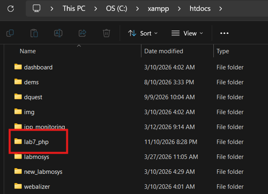

Selanjutnya buat index.php.

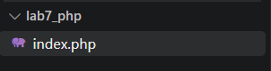

Buka Folder dalam url browser dengna mengetikan localhost/lab7_php/

### Latihan 1 --- Menjalankan PHP

Mengisi index.php.

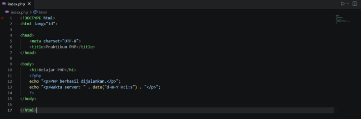

Hasilnya :

Muncul header "Belajar PHP" beserta waktu server saat diakses.

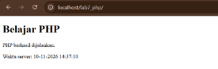

### Latihan 2 --- Variabel, operator, dan percabangan

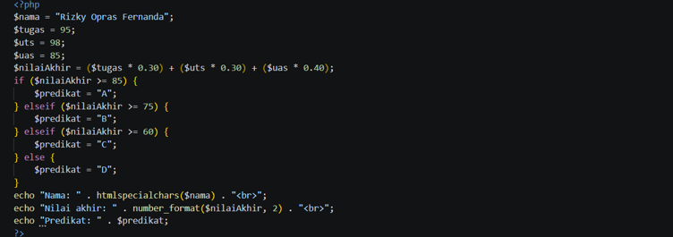

Hasilnya :

Program untuk menghitung nilai akhir, jika nilai akhir \>= 85
mendapatkan nilai A, nilai akhir \>= 75 mendapatkan nilai B, dan \>=60
mendapatkan nilai C dan dibawahnya akan mendapat nilai D.

### Latihan 3 --- Perulangan dan array

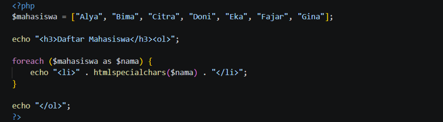

Hasilnya :

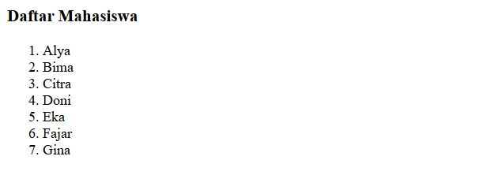

### Latihan 4 --- Membuat function

Buat function tambahan untuk menghitung luas persegi panjang atau
menentukan kelulusan berdasarkan nilai.

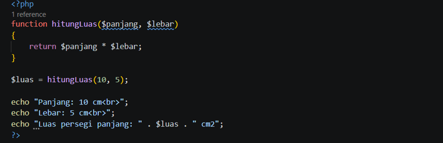

Hasilnya :

### Latihan 5 --- Memproses form dengan GET

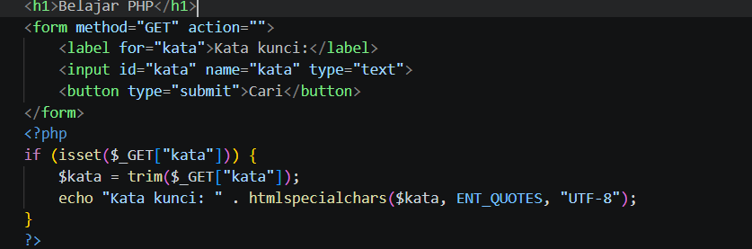

Hasilnya :

Akan muncul sebuah form input, dan hasil outputnya berasal dari input
yang diasukan.

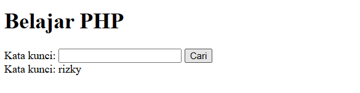

### Latihan 6 --- Memproses form dengan POST

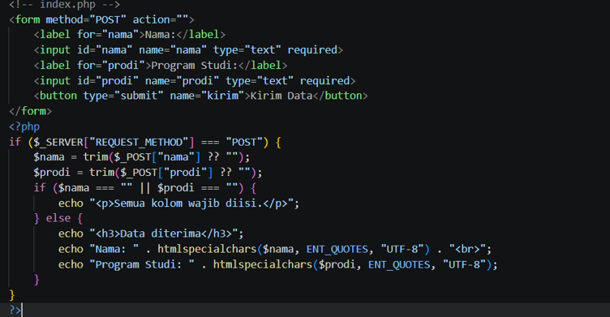

Hasilnya :

Muncul sebuah form.

- Jika diisi lengkap

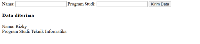

- Jika salah satu kosong akan muncul allert

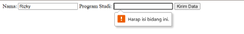

- Ketika dimasukan tag html hasilnya tidak berefek ke output

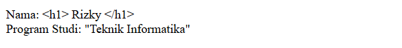

### Latihan 7 --- Pengolahan data sederhana

Buat form untuk memasukkan nama barang, harga, dan jumlah. PHP
menghitung subtotal dan menampilkan ringkasan transaksi.

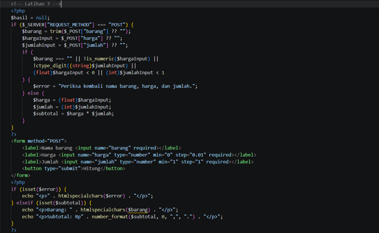

Hasilnya :

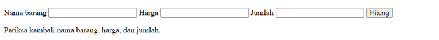

- Input Desimal :

Hasilnya :

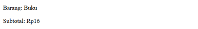

Subtotal dibulatkan menjadi bilangan bulat.

- Jumlah nol :

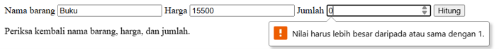

Muncul allert jumlah lebih besar atau sama dengan 1.

- Jumlah negative

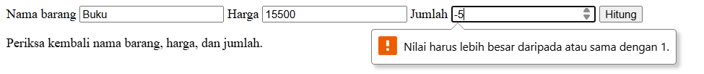

Muncul allert jumlah lebih besar atau sama dengan 1.

- Data tidak sesuai

Jika menginputkan huruf ke dalam kolom harga dan jumlah input tidak akan
mau.

### Mini Project --- Aplikasi Formulir Data Mahasiswa

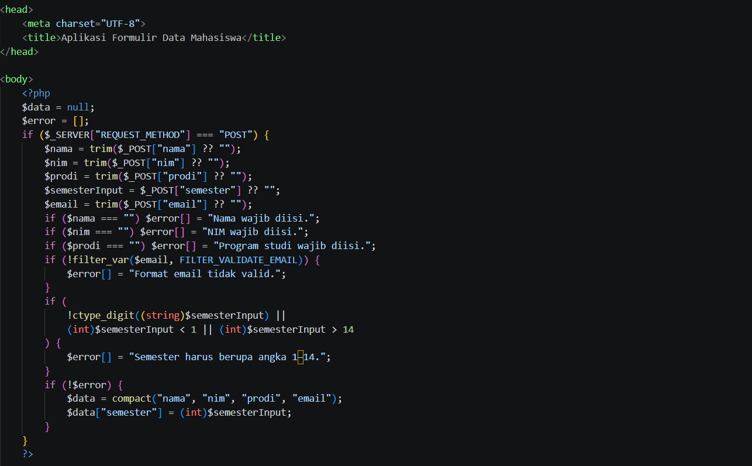

Hasilnya :

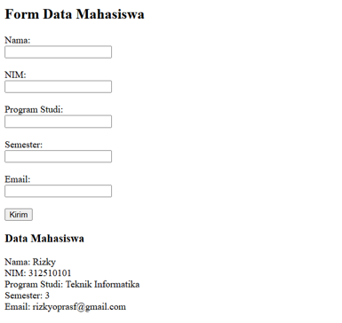

- Ketika data valid

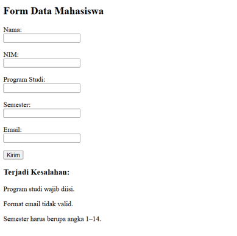

- Ketika terjadi kesalahan

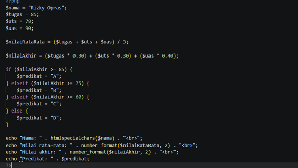

## Eksperimen Mandiri

### 1. Tambahkan perhitungan nilai rata-rata dari tiga komponen nilai.

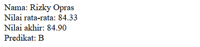

Hasilnya :

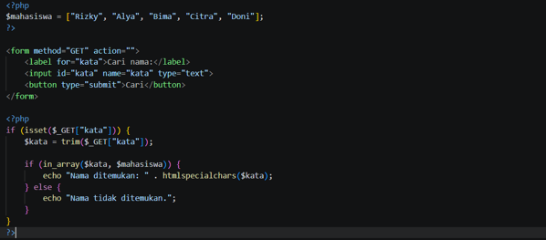

### 2. Ubah contoh GET agar dapat mencari nama dari array data sederhana.

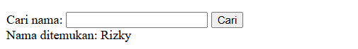

Hasilnya :

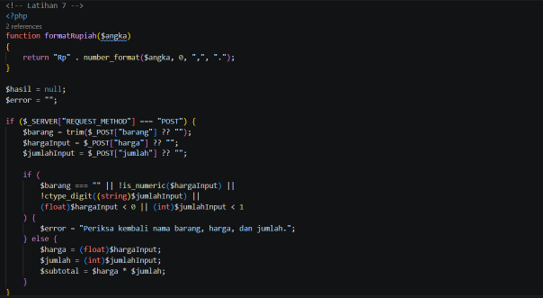

Jika nama yang dicari tidak ada dalam array maka akan munucl allert nama
tidak ditemukan.

### 3. Buat function untuk mengubah format harga menjadi Rupiah.

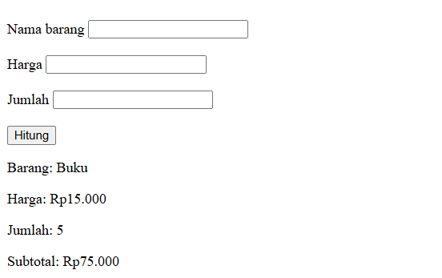

Hasilnya :

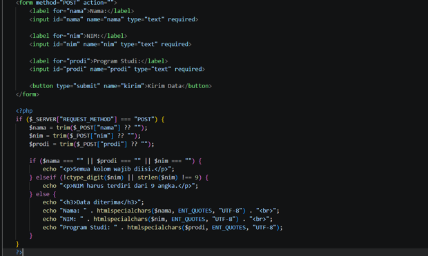

### 4. Tambahkan validasi agar NIM hanya berisi angka dan panjangnya sesuai ketentuan yang Anda tetapkan.

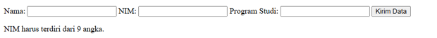

Hasilnya :

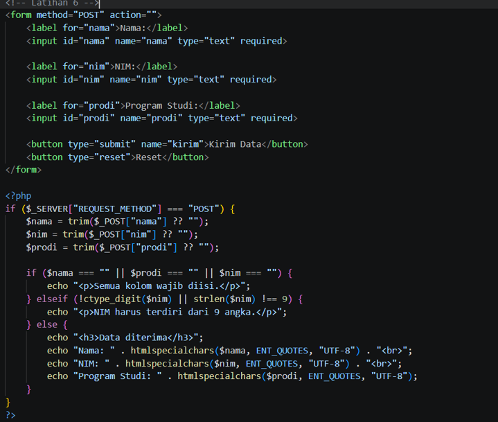

Jumlah NIM harus sesuai dengan batas yang telah ditentukan, disini saya
membatasi jumlahnya 9 karakter.

### 5. Tambahkan tombol reset pada form dan jelaskan perbedaannya dengan pemrosesan ulang di server.

Hasilnya :

Perbedaannya :

- Reset: Menghapus atau mengembalikan isi form ke kondisi awal secara
  langsung di browser tanpa mengirim data ke server.
- Pemrosesan ulang server: Mengirim kembali data ke server untuk
  diproses menggunakan PHP, termasuk menjalankan validasi.

## Pertanyaan Evaluasi

1.  **Apa perbedaan pemrosesan client-side dan server-side?**\
    Client-side diproses di browser pengguna, sedangkan server-side
    diproses di server.

2.  **Mengapa file PHP harus dijalankan melalui web server?**\
    Karena PHP membutuhkan web server seperti Apache untuk menjalankan
    kode PHP dan menampilkan hasilnya di browser.

3.  **Apa fungsi tanda \$ pada variabel PHP?**\
    Tanda \$ digunakan untuk menandai atau membuat variabel dalam PHP.

4.  **Apa perbedaan metode GET dan POST?**\
    GET mengirim data melalui URL, sedangkan POST mengirim data melalui
    request body sehingga tidak terlihat langsung di URL.

5.  **Mengapa input pengguna perlu divalidasi di sisi server?**\
    Untuk memastikan data yang dikirim sesuai aturan dan mencegah data
    yang tidak valid masuk ke sistem.

6.  **Apa fungsi htmlspecialchars() ketika menampilkan data dari
    form?**\
    Untuk mengamankan tampilan data dengan mengubah karakter khusus HTML
    agar tidak dijalankan sebagai kode HTML atau script.

7.  **Apa manfaat penggunaan function dalam program PHP?**\
    Agar kode lebih rapi, mudah digunakan kembali, dan tidak perlu
    menulis kode yang sama berulang kali.
